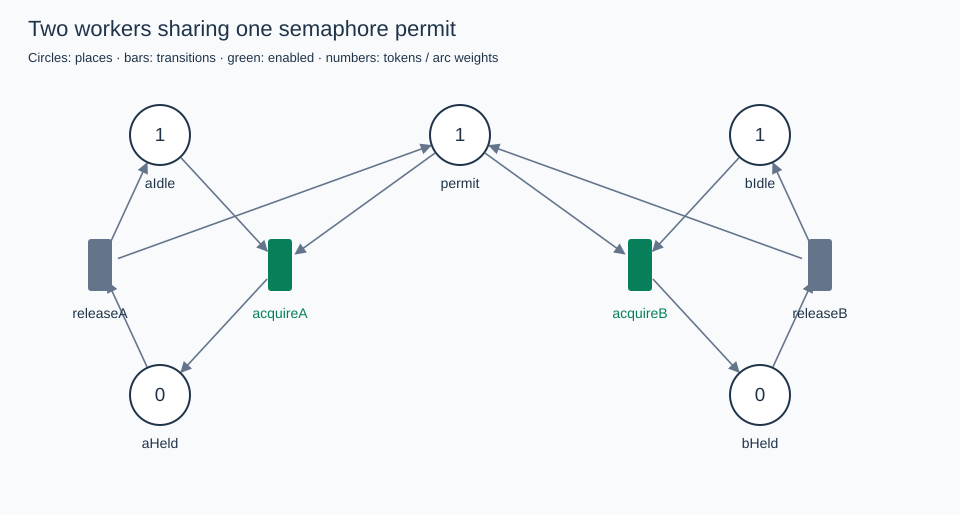
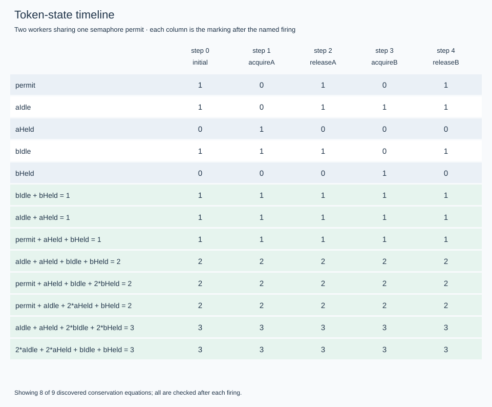

# Petri Net Token Conservation

A .NET 10 simulator for weighted Petri nets, demonstrating how exact linear algebra discovers conserved resources in concurrent systems.

Model a semaphore with one permit. Let two workers acquire and release it in any enabled order. The simulator discovers:

```text
permit + aHeld + bHeld = 1
```

The permit can move between places, but cannot disappear or be duplicated. A second example conserves both shared resources while reaching a deadlock: conservation and progress are different properties.



## Run

Requires the .NET 10 SDK. Runtime projects have no external package dependencies; the test project uses xUnit.

```powershell
dotnet build
dotnet test
dotnet run --project src/PetriNet.Cli -- --help
```

From the repository root:

```powershell
# Inspect the incidence matrix and discovered conservation equations.
dotnet run --project src/PetriNet.Cli -- invariants examples/semaphore.json

# Explore all enabled firing orders.
dotnet run --project src/PetriNet.Cli -- explore examples/semaphore.json

# Choose enabled transition IDs interactively; enter quit to finish.
dotnet run --project src/PetriNet.Cli -- simulate examples/semaphore.json

# Replay a particular valid execution.
dotnet run --project src/PetriNet.Cli -- simulate examples/semaphore.json --sequence acquireA,releaseA,acquireB,releaseB

# Generate diagrams, a timeline, a reachability graph, and a JSON report.
dotnet run --project src/PetriNet.Cli -- render examples/semaphore.json --sequence acquireA,releaseA,acquireB,releaseB --out artifacts/semaphore

# Find a terminal marking and show its shortest firing witness.
dotnet run --project src/PetriNet.Cli -- render examples/resource-deadlock.json --out artifacts/deadlock
```



To publish a framework-dependent CLI for the current platform:

```powershell
dotnet publish src/PetriNet.Cli -c Release --no-self-contained -o artifacts/publish
dotnet artifacts/publish/PetriNet.Cli.dll explore examples/semaphore.json
```

## Examples

| Net | Reachable markings | Firing edges | Terminal markings | Lesson |
| --- | ---: | ---: | ---: | --- |
| [Semaphore](examples/semaphore.json) | 3 | 4 | 0 | One permit guarantees mutual exclusion |
| [Producer/consumer](examples/producer-consumer.json) | 4 | 6 | 0 | Empty plus full buffer slots always equals three |
| [Resource sharing](examples/resource-sharing.json) | 3 | 4 | 0 | Acquire both resources atomically |
| [Resource deadlock](examples/resource-deadlock.json) | 6 | 8 | 1 | Opposite acquisition orders preserve resources but can deadlock |
| [Unbounded source](examples/unbounded.json) | Unbounded | Unbounded | 0 | Exploration limits produce partial results |

All four bounded examples have a discovered invariant certificate covering every place and zero invariant violations. Counts describe complete state graphs, including firing edges back to previously visited states.

In the deadlock example, the shortest witness is:

```text
takeR1A -> takeR2B
```

Worker A holds resource 1, worker B holds resource 2, and neither can obtain the remaining resource. Each resource still has exactly one token, counting both free and held representations. The examples model repeating workers, so their terminal marking represents deadlock. For arbitrary input, a terminal marking may instead represent successful completion.

## JSON model

A minimal weighted net:

```json
{
  "name": "Weighted transfer",
  "places": [
    { "id": "a", "initial": 4 },
    { "id": "b", "initial": 0 }
  ],
  "transitions": [
    { "id": "transfer", "inputs": { "a": 2 }, "outputs": { "b": 3 } }
  ]
}
```

This net conserves `3*a + 2*b = 12`.

Place and transition IDs are case-sensitive and unique within their respective sets. Token counts are nonnegative integer JSON numbers; arc weights are positive integer numbers. Arithmetic uses `BigInteger`, so tokens and weights are not limited to machine integers. Every transition requires `inputs` and `outputs`, which may be empty objects. At least one place is required; zero transitions are allowed.

Unknown properties, duplicate JSON keys, unknown arc endpoints, fractional values, missing required fields, negative initial markings, and nonpositive weights are rejected. Each place and transition may optionally include `"position": { "x": 120, "y": 100 }` with finite coordinates for the net diagram. Otherwise, a deterministic bipartite layout is used.

There are no capacities, inhibitor/reset arcs, priorities, durations, colors, or parallel multi-transition firing steps. Concurrency is represented by the possible interleavings of atomic transition firings.

## Semantics and algebra

Let `Pre[p,t]` be the input weight and `Post[p,t]` the output weight. The incidence matrix has places as rows and transitions as columns:

```text
C = Post - Pre
```

Transition `t` is enabled exactly when `m[p] >= Pre[p,t]` for every place. Firing returns a new immutable marking:

```text
m' = m - Pre[:,t] + Post[:,t]
```

Enabling uses the input matrix, not just the incidence matrix. A transition consuming and replacing one token in the same place has zero incidence there, but still needs that input token.

For any nonnegative integer vector `y` satisfying `C^T y = 0`:

```text
y^T m' = y^T m + y^T C[:,t] = y^T m
```

Induction over a firing sequence gives `y^T m = y^T m0` for every reachable marking. The algebraic equation proves conservation independently of reachability enumeration. During simulation and exploration, the implementation also checks every discovered invariant after each recorded firing.

A positive weight gives the place bound `m[p] <= floor((y^T m0) / y[p])`. If discovered invariants cover every place, these bounds certify a finite state space. Missing coverage does not establish unboundedness.

The analyzer computes an exact rational nullspace through reduced row echelon form, clears denominators, and divides by the coefficient GCD. A rational basis may have mixed signs. Therefore it also searches integer combinations of the primitive basis vectors, normalizing and checking every accepted nonnegative candidate.

**Invariant discovery is incomplete.** It searches a coefficient box controlled by `--bound` and `--max-combinations`; it does not compute a Hilbert basis, all minimal invariants, or an integer lattice basis. Results can include dependent sums of simpler invariants. `search truncated: False` means the requested coefficient box was exhausted, not that all nonnegative invariants were found. The nullspace dimension is exact; the discovered-invariant count is not a count of independent conserved quantities.

Discovered invariants describe the supplied model. They do not establish that the model captures every intended real-world resource rule. The runtime checks detect inconsistencies with those equations; expected resource laws also have dedicated regression tests.

Reference: [Stefan Schwoon, Petri nets, place invariants](https://www.lsv.fr/~schwoon/enseignement/verification/ws1314/nets.pdf).

## Exploration, reports, and limits

Breadth-first search deduplicates markings by structural token equality and retains all explored firing edges. First-discovery parents provide shortest witnesses. Markings with no enabled transitions are reported as terminal. This project does not analyze temporal logic, fairness, starvation, or general liveness.

```powershell
dotnet run --project src/PetriNet.Cli -- explore examples/unbounded.json --max-states 100 --max-edges 1000 --seconds 5 --report artifacts/unbounded/report.json
```

Defaults are 10,000 states, 100,000 edges, and 10 seconds of exploration; invariant discovery defaults to bound 2 and 100,000 combinations. The time limit applies to exploration, not JSON loading, exact algebra, or rendering. Ctrl+C requests cancellation, checked during algebra and exploration; an interactive read may need input to return before cancellation is observed.

| Exit code | Meaning |
| --- | --- |
| 0 | Command succeeded; exploration completed if requested |
| 1 | Invalid input, disabled requested firing, or file/command error |
| 2 | Exploration stopped at a state, edge, or time limit |
| 3 | Exploration detected an invariant violation |
| 130 | Cancelled |

A limit does not change enabling or impose artificial token capacities. Partial results cannot establish complete state-space size, absence of deadlock, or unboundedness. Exact state-space size is reported only after complete exploration.

`render` writes:

- `net.svg`: the final marking of the selected trace, with enabled transitions highlighted.
- `timeline.svg`: token counts along the trace and up to eight discovered conservation equations; every discovered invariant is checked.
- `reachability.svg`: an overview for graphs with at most 100 states and 500 edges. Larger graphs are omitted; an old graph at that path is removed.
- `report.json`: incidence matrix, exact integer-scaled nullspace basis, discovered invariants and bounds, state/edge inventory, terminal witnesses, violations, completion status, and timing metrics.

By default the trace goes to the first discovered terminal marking, or to the last discovered marking if none was found. Use `--state N` for a shortest path to a selected state, or `--sequence id,id,...` for a particular execution. Graphs use simple deterministic layouts, not a general graph-layout engine; dense graphs may have overlapping edges or labels.

Reports encode arbitrary-precision token counts, weights, constants, bounds, and matrix entries as decimal strings. State indices, metric counts, and timings are JSON numbers. `conservedQuantities` counts discovered equations, including dependent ones. `transitionsExplored` counts firing edges, not distinct transition definitions. `stateSpaceSize` is null for partial exploration. Reports and SVGs overwrite files at the requested destination.

## Development

```powershell
dotnet test -c Release
dotnet format --verify-no-changes --no-restore
git diff --check
```

`PetriNet.Core` contains immutable state, token-flow semantics, strict JSON loading, exact fractions/nullspaces, invariant discovery, and reachability exploration. `PetriNet.Cli` contains command orchestration, reports, and SVG rendering. Tests cover weighted arcs, self-loops, invalid models, arbitrary-precision tokens, mixed-sign basis combinations, independent small-matrix rank checks, known state graphs, deadlock witnesses, limits, cancellation, CLI behavior, and XML-safe rendering.

Generated working output belongs under ignored `artifacts/`. The two checked-in SVGs above are documentation samples generated by the semaphore render command. No network services are needed at runtime.
